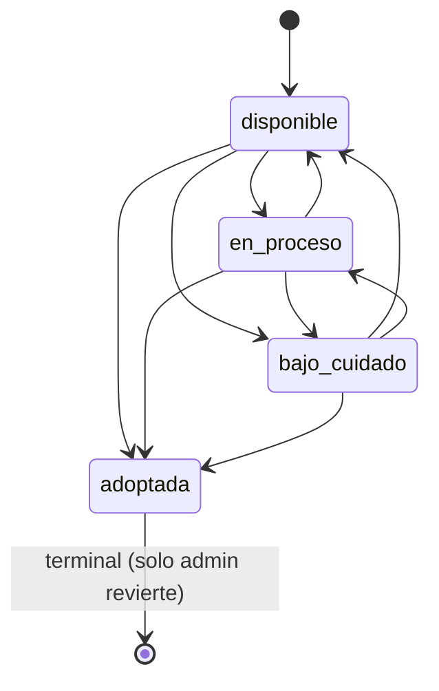
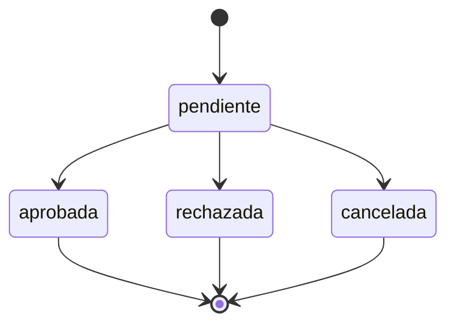
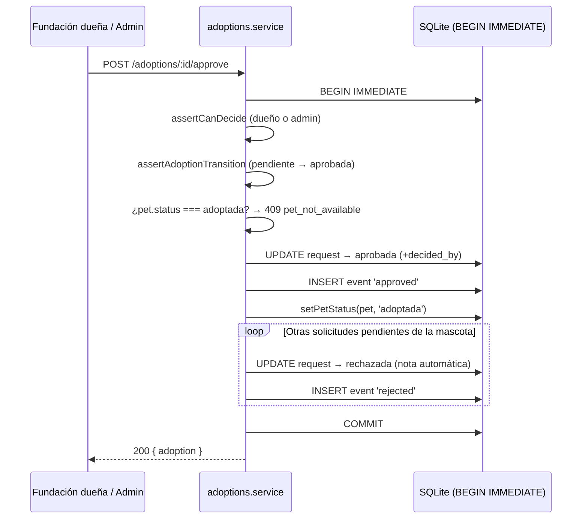
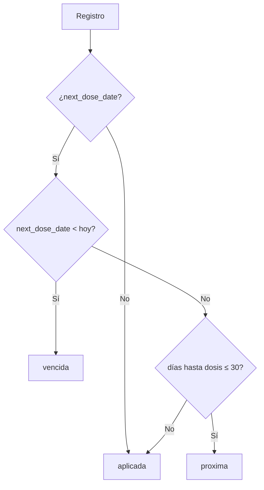
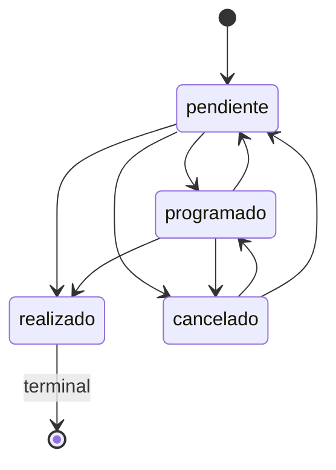

# PetGuardian — Algoritmos y Reglas de Negocio

Reglas verificadas en los servicios del backend
(`backend/src/services/*.service.js`), sus configuraciones
(`backend/src/config/*.js`) y las consultas de `backend/src/data/*.repository.js`.
Todas las reglas se aplican en el **servidor**.

---

## 1. Cálculo de edad de la mascota

`pets.service.js` → `computeAgeMonths` + `formatAge`:

1. Si `approximate_age_months` tiene valor, se usa directamente.
2. Si no, y existe `birth_date`, se calcula en meses UTC:
   `(añoActual − añoNac)·12 + (mesActual − mesNac)`, restando 1 mes si el día
   actual es anterior al de nacimiento.
3. Si el resultado es negativo, se limita a `0`. Si no hay datos, `null`.

`formatAge`:

| Meses | Etiqueta |
| --- | --- |
| `null` | `null` (sin dato) |
| `< 1` | `menos de 1 mes` |
| `1` | `1 mes` |
| `2..23` | `N meses` |
| `≥ 24` | `N años` (`1 año` si N = 1) |

La edad **nunca** se inventa: sin datos, `ageMonths` y `ageLabel` son `null`.

---

## 2. Máquina de estados de la mascota

`ALLOWED_STATUS_TRANSITIONS` (`config/pets.js`):



| Desde | Hacia permitidos |
| --- | --- |
| `disponible` | `en_proceso`, `adoptada`, `bajo_cuidado` |
| `en_proceso` | `disponible`, `adoptada`, `bajo_cuidado` |
| `bajo_cuidado` | `disponible`, `en_proceso`, `adoptada` |
| `adoptada` | *(ninguno)* |

Reglas de `assertValidTransition`:

- Si el estado no cambia (`from === to`), se permite.
- Un **admin** puede forzar cualquier transición (incluida revertir `adoptada`).
- Para el resto (fundación dueña), solo se permiten las transiciones de la tabla.
- Intentar salir de `adoptada` sin ser admin →
  `409 invalid_status_transition` con mensaje específico.

---

## 3. Detección de mascotas duplicadas

`createPet` ejecuta `findPotentialDuplicate({ ownerId, species, name, birthDate })`.
Si existe una mascota **del mismo dueño** con el mismo nombre, especie y fecha
de nacimiento → `409 possible_duplicate`. La comprobación es previa a la
inserción y solo aplica en **creación**.

---

## 4. Máquina de estados de la adopción

`ALLOWED_ADOPTION_TRANSITIONS` (`config/adoptions.js`):



- `ADOPTION_OPEN_STATUSES` = `[pendiente]` (cuentan como solicitud abierta).
- `ADOPTION_TERMINAL_STATUSES` = `[aprobada, rechazada, cancelada]`.
- `canTransition(from, to)` valida contra la tabla; si no, `409
  invalid_status_transition`. Editar (`PUT`) exige estado `pendiente`
  (`assertEditableStatus`).

### 4.1 Crear solicitud (`createRequest`)

Dentro de una transacción `BEGIN IMMEDIATE` (`runImmediateTransaction`):

1. Si la mascota no existe → `404 pet_not_found`.
2. Si la mascota está `adoptada` → `409 pet_not_available`.
3. Si el solicitante ya tiene una solicitud **abierta** para esa mascota →
   `409 duplicate_request`.
4. Crea la solicitud (`pendiente`) y un evento `created`.
5. Si la mascota estaba `disponible`, la pasa a `en_proceso`.
6. Devuelve la solicitud hidratada (con datos de mascota y solicitante).

> El adoptante queda fijado como `applicant_id` de la sesión; nunca se confía en
> un `applicantId` del cliente.

### 4.2 Aprobar (`approveRequest`) — transacción crítica



Detalles:

- Nota automática: `"Se aprobo otra solicitud para esta mascota."`
- El índice único parcial (`WHERE status='aprobada'`) refuerza la integridad si
  algo escapa de la lógica de aplicación.
- La comprobación de mascota `adoptada` ocurre **dentro** de la transacción, por
  lo que dos aprobaciones concurrentes se serializan: la segunda detecta el
  conflicto y responde `409 pet_not_available`.

### 4.3 Rechazar (`rejectRequest`) y cancelar (`cancelRequest`)

- Rechazar: `assertCanDecide` (fundación dueña o admin) + transición a
  `rechazada` + evento + `releasePetIfFree`.
- Cancelar: `assertCanView` + `assertCanEditOwn` (solicitante o admin) +
  transición a `cancelada` + evento + `releasePetIfFree`.

### 4.4 Liberación de la mascota (`releasePetIfFree`)

Si la mascota está `en_proceso` **y** no quedan solicitudes abiertas
(`countOpenRequests === 0`), vuelve a `disponible`. Si aún hay pendientes,
permanece en `en_proceso`. Nunca libera una mascota `adoptada`.

### 4.5 Editar solicitud (`updateRequest`)

- Debe estar `pendiente` (si no → `409`).
- Solo el **solicitante** (o admin). La fundación no edita.
- Actualiza `message` y registra un evento `edited` (fromStatus = toStatus =
  `pendiente`).

---

## 5. Estados clínicos calculados (vacunas y desparasitación)

`MEDICAL_RECORD_TYPES.*.statusKind`:

- `expiry` → `vaccinations`, `deworming`.
- `stored` → `procedures`, `appointments`, `consultations`.
- `treatment` → `treatments` (calculado por fechas).

### 5.1 Cálculo `expiry` (`computeExpiryStatus`)

Sea `today` = fecha UTC `AAAA-MM-DD` y `VACCINE_UPCOMING_DAYS = 30`:



- `APLICADA` = "Aplicada".
- `PROXIMA` = "Proxima dosis" (dentro de 30 días).
- `VENCIDA` = "Vencida".

El estado **no** se almacena para estos tipos: se recalcula en cada lectura.

### 5.2 Estados almacenados (`stored`)

`procedures` y `appointments` guardan `status` en la BD; `toMedicalResponse`
añade solo la etiqueta legible.

### 5.3 Consultas

`consultations` guarda `status` (`abierta`/`cerrada`). Una consulta cerrada es
**inmutable** salvo reapertura explícita (`cerrada → abierta`, sin tocar otros
campos), que queda auditada (`reopened`). Intentar editarla estando cerrada →
`409 consultation_closed`.

### 5.4 Estado de tratamiento (`computeTreatmentStatus`)

`treatments` (`statusKind: treatment`) calcula el estado por fechas (no se
almacena), con `today` UTC:

- `start_date` futuro → `programado`.
- `end_date` anterior a hoy → `finalizado`.
- en otro caso → `vigente`.

Etiquetas: `programado`/"Programado", `vigente`/"Vigente",
`finalizado`/"Finalizado".

---

## 6. Integridad de procedimientos

`assertProcedureIntegrity(next)` (aplicada en creación **y** actualización):

1. Si `performedDate` es futura → `409 invalid_performed_date`.
2. Si `status === realizado`:
   - Sin `performedDate` → `409 procedure_not_completed`
     ("No puedes marcar como realizado un procedimiento sin fecha de realización").
   - `performedDate` futura → `409 procedure_not_completed`.
3. Si `followUpDate` es anterior a `performedDate` → `409 invalid_follow_up_date`
   ("El próximo control no puede ser anterior a la fecha de realización").

`assertProcedureTransition(from, to)` usa `ALLOWED_PROCEDURE_TRANSITIONS`:



| Desde | Hacia permitidos |
| --- | --- |
| `pendiente` | `programado`, `realizado`, `cancelado` |
| `programado` | `pendiente`, `realizado`, `cancelado` |
| `cancelado` | `programado`, `pendiente` |
| `realizado` | *(ninguno — terminal)* |

Si `from === to`, se permite. En creación no hay transición (no comprueba el
estado previo), solo integridad.

---

## 6.1 Reglas de citas (agenda)

`appointments` combina tres controles:

1. **Transición de estado** (`assertAppointmentTransition`):
   `programada → completada|cancelada`; `completada` es terminal (`[]`);
   `cancelada → programada` (reactivación/reprogramación).

   ```mermaid
   stateDiagram-v2
     [*] --> programada
     programada --> completada
     programada --> cancelada
     cancelada --> programada
     completada --> [*]: terminal
   ```

2. **Integridad temporal** (`assertAppointmentIntegrity`): una cita `programada`
   no puede quedar en una fecha **pasada** → `409 appointment_in_past`. Al
   actualizar solo se comprueba si la petición envía `scheduledAt` (para poder
   editar/cerrar citas antiguas sin bloquear).

3. **Conflicto de agenda** (`assertAppointmentNoConflict`): no puede existir otra
   cita **activa** (no `cancelada` ni anulada) en el **mismo `scheduled_at`** del
   mismo **paciente** o del mismo **veterinario** → `409 schedule_conflict`
   (`details.scheduledAt`). El propio registro se excluye al reprogramar. Se
   reevalúa cuando la petición cambia `scheduledAt`, `veterinarianId` o `status`.

---

## 7. Reglas de validación de fechas médicas

- `appliedDate` / `consultationDate`: formato `AAAA-MM-DD`, **no futuras**
  (`NO_FUTURE_DATE_FIELDS`). Si son futuras → `400 validation_error`.
- `scheduledAt` (citas): se normaliza a `AAAA-MM-DD HH:MM:SS`; debe ser un
  datetime válido.
- `scheduledDate` / `performedDate` / `nextDoseDate`: `AAAA-MM-DD`.
- `veterinarianId`, si viene informado, debe corresponder a un usuario
  existente **y con rol `veterinario`** (`assertValidVeterinarian` →
  `400 validation_error`; `details.veterinarianId`).
- `startDate`/`endDate` (tratamientos): `AAAA-MM-DD`.
- Signos vitales (consulta): rango validado en `VITAL_SIGNS` — `weightKg`
  0.1–200, `temperatureC` 25–45, `heartRateBpm` 20–400 (entero),
  `respiratoryRateRpm` 5–200 (entero).

---

## 8. Reglas de la API clínica (`MEDICAL_RECORD_TYPES`)

Cada tipo declara su tabla, el mapeo campo→columna, campos requeridos, fechas,
datetimes, límites de texto, enums, defaults y `statusKind`. De ahí se generan
la validación y el repositorio (una sola fuente de verdad).

| Tipo | Requeridos | Enums | Defaults | Orden de listado |
| --- | --- | --- | --- | --- |
| `vaccinations` | `vaccineName`, `appliedDate` | — | — | `applied_date DESC, id DESC` |
| `deworming` | `productName`, `appliedDate` | `dewormingType` | `dewormingType=interna` | `applied_date DESC, id DESC` |
| `procedures` | `procedureType` | `status` | `status=pendiente` | `created_at DESC, id DESC` |
| `appointments` | `reason`, `scheduledAt` | `status` | `status=programada` | `scheduled_at ASC, id ASC` |
| `consultations` | `reason`, `consultationDate` | `status` | `status=abierta` | `consultation_date DESC, id DESC` |
| `treatments` | `medication`, `startDate` | — | — | `start_date DESC, id DESC` |

Límites de texto (`MEDICAL_LIMITS`): `nameMax 120`, `batchMax 60`,
`diagnosisMax 1000`, `treatmentMax 1000`, `notesMax 1000`, `examinationMax 2000`,
`findingsMax 2000`, `evolutionMax 2000`, `profileTextMax 2000`, `doseMax 120`,
`routeMax 60`, `frequencyMax 120`, `durationMax 120`, `instructionsMax 1000`,
`preOpMax 1000`, `postOpMax 1000`. Campos numéricos validados por rango
(`numbers` + `VITAL_SIGNS`) solo en `consultations`.

Los `defaults` solo se aplican si el usuario **no** envió el campo
(`{ ...defaults, ...input }`). En actualización solo se modifican los campos
presentes en la petición (los campos derivados —`statusLabel`,
`dewormingTypeLabel`, `veterinarianName`— se descartan antes de escribir).

---

## 9. Reglas de acceso clínico (`canAccessPetMedical`)

```
si rol ∉ MEDICAL_READ_ROLES            → false (403)
si rol === admin                        → true (cualquier mascota)
si rol === veterinario                  → isVetAssigned(pet.id, user.id)
si rol === fundacion                    → pet.ownerId === user.id
```

Se aplica en **lectura y escritura** (list/get/create/update/delete), en los
antecedentes (perfil), la auditoría y los controles; no solo por rol de ruta,
para no filtrar el historial clínico. Un veterinario **no asignado** a la mascota
recibe `403` aunque su rol esté en `MEDICAL_READ_ROLES`.

### Vínculo veterinario ↔ mascota (`vet_pet_assignments`)

- Gestiona el vínculo quien puede gestionar la mascota (`canManagePet`): `admin`
  o la fundación propietaria. El veterinario no puede auto-asignarse.
- La desasignación es lógica (`is_active = 0`); se conserva quién asignó/retiró.
- De este vínculo dependen el acceso clínico del veterinario, la agenda, el
  calendario y el alcance del panel.

---

## 10. Algoritmo del panel (`buildDashboard`)

Alcance (`scope`):

- `fundacion` → `ownerId = user.id` (solo sus mascotas).
- `veterinario` → `assignedVetId = user.id` (solo sus pacientes asignados).
- `admin` / `adoptante` → sin filtro (`null`, global).

Secciones según rol:

- `pets` → siempre (`countPets`).
- `adoptions` → si rol ∈ `ADOPTION_READ_ROLES`, con ámbito:
  - `adoptante` → `applicantId = user.id`.
  - `fundacion` → `ownerId = user.id`.
  - `admin` → global.
- `medical` + `attention` → si rol ∈ `MEDICAL_READ_ROLES`.

### 10.1 Métricas calculadas (SQL real)

| Métrica | Definición |
| --- | --- |
| `pets.total` | `COUNT(*)` de mascotas en alcance |
| `pets.perros` / `gatos` | `SUM(species=perro/gato)` |
| `pets.disponibles` / `enProceso` / `adoptadas` / `bajoCuidado` | `SUM(status=...)` |
| `adoptions.pendientes` / `aprobadas` / `total` | `SUM(status=...)` + `COUNT(*)` |
| `medical.vacunasProximas` | vacunas con `next_dose_date` entre hoy y hoy+30 |
| `medical.vacunasVencidas` | vacunas con `next_dose_date < hoy` |
| `medical.desparasitacionesProximas` / `Vencidas` | igual, sobre `deworming_records` |
| `medical.cirugiasPendientes` | procedimientos en `pendiente` o `programado` |
| `medical.proximasCitas` | citas `programada` con `scheduled_at ≥ ahora` |

> **No** existe métrica `adoptions.rechazadas`.

### 10.2 Lista de atención (`listAttentionPets`)

Devuelve hasta **6** mascotas que cumplen al menos una condición de alerta, con
el recuento real por tipo:

| Campo | Regla |
| --- | --- |
| `vacunasVencidas` | vacunas con `next_dose_date < hoy` |
| `vacunasProximas` | vacunas con dosis entre hoy y hoy+30 |
| `desparasitacionesVencidas` | desparasitaciones con `next_dose_date < hoy` |
| `desparasitacionesProximas` | desparasitaciones con dosis entre hoy y hoy+30 |
| `cirugiasPendientes` | procedimientos `pendiente`/`programado` |
| `citasProximas` | citas `programada` con `scheduled_at ≥ ahora` |

**Filtro:** se incluye la mascota si la suma de esos seis contadores es > 0.

**Fechas agregadas:**

- `proximaFecha` = fecha futura más cercana entre dosis (vacunas y
  desparasitación), citas programadas y procedimientos con fecha ≥ hoy.
- `vencidaFecha` = vencimiento más antiguo entre vacunas y desparasitaciones.

**Orden (fórmula de prioridad):**

```
vacunasVencidas·100 + desparasitacionesVencidas·100
+ cirugiasPendientes·10 + vacunasProximas·5
+ desparasitacionesProximas·5 + citasProximas
```

Descendente; a igualdad, orden por `name ASC`.

---

## 11. Alertas en el frontend (`constants/alerts.js`)

Fuente única de alertas de UI, derivada de los campos anteriores:

- `ATTENTION_METRICS`: `vacunasVencidas` y `desparasitacionesVencidas`
  (`danger`), `cirugiasPendientes` (`warn`), `vacunasProximas`,
  `desparasitacionesProximas` y `citasProximas` (`info`).
- `attentionIsCritical`: true si existe cualquier métrica de tipo `danger`.
- `attentionCount`: suma de todas las métricas de la mascota.
- `buildMedicalAlerts(attentionPets)`: genera la lista ordenada de alertas.

---

## 12. Reglas de autenticación y sesión

`password.service.js`:

- **Hash:** `scrypt` con `N=16384`, `r=8`, `p=1`, `keylen=64`, sal aleatoria de
  16 bytes. Formato: `scrypt$N$r$p$saltB64$hashB64`.
- **Verificación:** `timingSafeEqual` sobre las claves derivadas.
- **Token de sesión:** `randomBytes(32).toString("base64url")`.
- **Hash de token:** SHA-256 (`hashSessionToken`); en BD solo el hash.

`auth.service.js`:

- `register`: normaliza email (minúsculas) y `fullName` (trim); crea el usuario;
  rechaza email duplicado (`409 email_taken`).
- `login`: busca por email normalizado; verifica contraseña; elimina sesiones
  expiradas; inserta sesión con `expires_at = ahora + TTL`.
- `resolveUserByToken`: hashea el token, busca la sesión; si `expires_at` ya
  pasó, la borra y devuelve `null`; si no, actualiza `last_used_at`
  (`touchSession`).
- `logout`: borra la sesión por hash.

`SESSION_TTL_HOURS` por defecto `168` (7 días).

---

## 13. Reglas de foto de mascota

`pets.validation.js` con `PET_LIMITS`:

- `photoUrl` `http(s)://` con longitud ≤ `2048`, **o** data URL de imagen.
- Data URL: MIME ∈ `image/png`, `image/jpeg`, `image/webp`; tamaño decodificado
  ≤ `photoBytesMax` (2 MiB).
- Para PNG se verifica la **firma de bytes mágicos** (`89 50 4E 47...`); una
  cabecera declarada como PNG que no lo sea se rechaza (`400 validation_error`).

---

## 14. Resumen de códigos de conflicto (`409`)

| Código | Cuándo |
| --- | --- |
| `email_taken` | Registro con email existente |
| `possible_duplicate` | Mascota duplicada por dueño + nombre + especie + fecha |
| `duplicate_request` | El adoptante ya tiene solicitud abierta para esa mascota |
| `pet_not_available` | Mascota ya adoptada (crear o aprobar) |
| `invalid_status_transition` | Transición de mascota, adopción o procedimiento no permitida |
| `procedure_not_completed` | Marcar `realizado` sin fecha válida |
| `invalid_performed_date` | Fecha de realización futura |
| `invalid_follow_up_date` | Próximo control anterior a la fecha de realización |
| `appointment_in_past` | Cita `programada` en fecha pasada |
| `schedule_conflict` | Cita activa duplicada en el mismo horario (mismo paciente o veterinario) |
| `consultation_closed` | Editar una consulta cerrada sin reabrirla |
