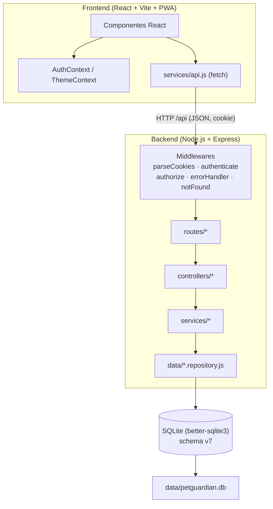
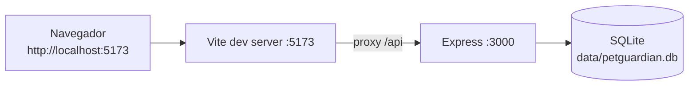
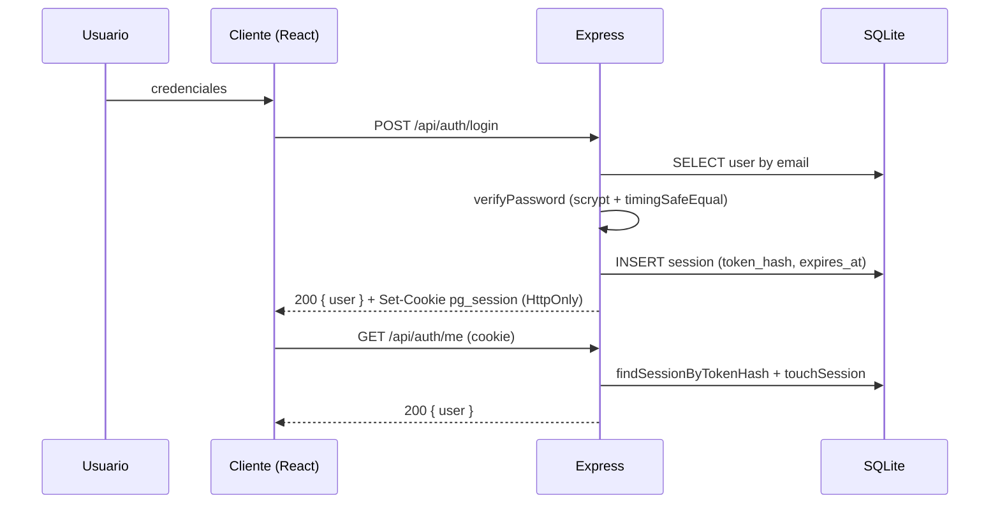
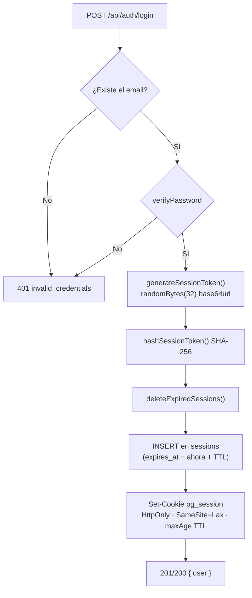
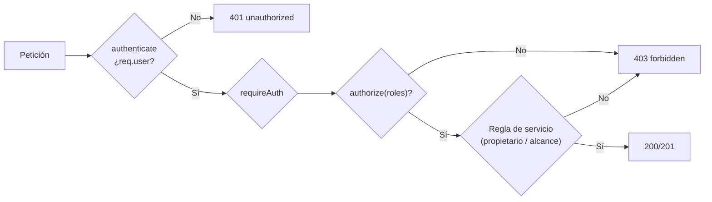
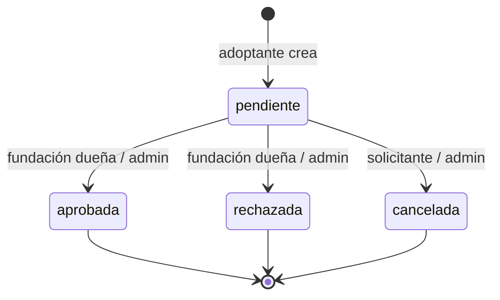
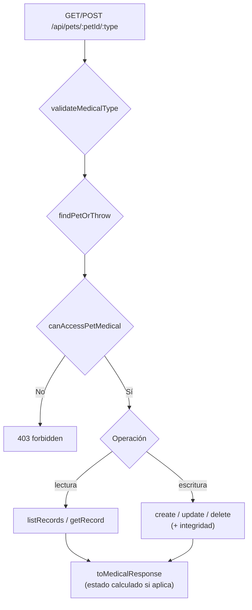
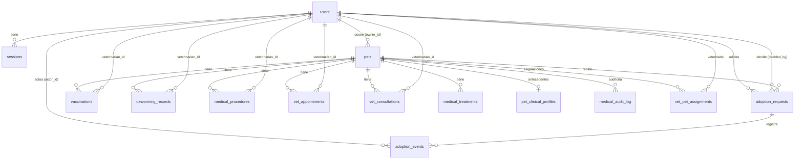

# PetGuardian — Arquitectura y Documentación Técnica

> Documento maestro de ingeniería. Describe **únicamente** lo que existe en el
> repositorio y está verificado por lectura directa del código y por la suite de
> pruebas (`node --test`, 132 pruebas / 40 suites). No se documentan endpoints,
> tablas, algoritmos, campos ni funcionalidades que no estén implementados.

- **Versión de la aplicación:** `0.1.0`
- **Versión del esquema de base de datos:** `7`
  (`vital_signs_treatments_and_surgical_followup`)
- **Especies admitidas:** exclusivamente `perro` y `gato`
- **Idioma de la interfaz:** español

Índice de documentos relacionados:

- [`API.md`](./API.md) — referencia de endpoints.
- [`BASE_DE_DATOS.md`](./BASE_DE_DATOS.md) — esquema, migraciones y modelo ER.
- [`ROLES_Y_PERMISOS.md`](./ROLES_Y_PERMISOS.md) — matriz de acceso RBAC.
- [`ALGORITMOS_Y_REGLAS.md`](./ALGORITMOS_Y_REGLAS.md) — reglas de negocio y máquinas de estado.
- [`GUIA_DE_DEMOSTRACION.md`](./GUIA_DE_DEMOSTRACION.md) — guion de demo por rol.

---

## 1. Resumen ejecutivo

PetGuardian es una aplicación web **responsive** e instalable como **PWA** para
la gestión de perros y gatos en un refugio o fundación, con tres áreas
funcionales principales:

1. **Gestión de mascotas** — CRUD, búsqueda, filtros y estados.
2. **Adopciones** — solicitudes de adoptantes, revisión y decisión por la
   fundación responsable, con historial de eventos.
3. **Expediente clínico** — carnet de vacunación, desparasitación,
   procedimientos/cirugías, citas, consultas (con signos vitales), tratamientos,
   antecedentes/alergias, auditoría y controles; con agenda y calendario
   clínicos y vínculo veterinario↔paciente.

A lo anterior se suma un **panel con métricas reales** (agregaciones SQL, nunca
cifras inventadas) que se adapta al rol del usuario y actúa como centro de
operaciones o centro clínico.

El sistema se distribuye como **monorepo**: un backend Node.js/Express con
SQLite y un frontend React/Vite.

---

## 2. Objetivo del sistema

Centralizar el ciclo de vida de un animal rescatado en una sola herramienta:
registro, seguimiento de su salud, publicación para adopción, gestión de
solicitudes y trazabilidad de las decisiones, con **control de acceso por
roles** verificado íntegramente en el servidor.

---

## 3. Alcance funcional

| Módulo | Incluido |
| --- | --- |
| Usuarios y sesiones | Registro público (3 roles), login, logout, sesión con cookie, listado de usuarios (admin) |
| Mascotas | Crear, listar/buscar/filtrar, ver detalle, editar, eliminar, estados con transiciones, foto opcional |
| Adopciones | Crear solicitud, listar por rol, ver detalle, editar observaciones, aprobar, rechazar, cancelar, historial de eventos |
| Salud veterinaria | 6 tipos de registro con CRUD, expediente (perfil/auditoría/controles), agenda y calendario clínicos, vínculo veterinario↔paciente y directorio de veterinarios |
| Panel | Métricas reales por rol + mascotas que requieren atención + actividad reciente |
| Presentación | Tema claro/oscuro/sistema, PWA, iconografía SVG propia |

---

## 4. Exclusiones y limitaciones

Lo siguiente **no** está implementado y no debe suponerse:

- Sin notificaciones ni recordatorios automáticos (correo, push).
- Sin recuperación de contraseña ni verificación de correo.
- Sin exportación de expediente a PDF.
- Sin tests end-to-end en navegador (la suite es de API con `node --test`).
- Sin lint, typecheck ni tests en el frontend; el proyecto es **JavaScript**, no
  TypeScript.
- Sin repositorio Git inicializado (según el entorno indicado).
- Las "consultas" clínicas registran signos vitales, examen, hallazgos,
  diagnóstico y evolución, y tienen estado `abierta`/`cerrada` (una consulta
  cerrada es inmutable salvo reapertura auditada); **no** generan alertas en el
  panel.
- Las alertas del panel se derivan solo de vacunas, desparasitaciones,
  procedimientos activos y citas programadas. Los "controles próximos" (citas
  programadas futuras + `followUpDate` de procedimientos) y los "tratamientos
  vigentes" se muestran en el expediente y la agenda, no como alertas.

---

## 5. Actores y roles

Cuatro roles (`backend/src/config/roles.js`):

| Rol | Valor | Etiqueta | Descripción |
| --- | --- | --- | --- |
| Administrador | `admin` | Administrador | Acceso global; no elegible en registro público |
| Fundación | `fundacion` | Fundación | Dueña de mascotas; decide adopciones de **sus** mascotas |
| Adoptante | `adoptante` | Adoptante | Explora mascotas y crea solicitudes |
| Veterinario aliado | `veterinario` | Veterinario aliado | Gestiona el expediente clínico de **sus pacientes asignados** (`vet_pet_assignments`) |

Detalle completo de permisos en [`ROLES_Y_PERMISOS.md`](./ROLES_Y_PERMISOS.md).

---

## 6. Requisitos funcionales (por módulo)

**Autenticación**
- RF-A1: registro con email único, contraseña ≥ 8 caracteres y rol no admin.
- RF-A2: login que emite cookie de sesión `HttpOnly`.
- RF-A3: logout que invalida el token en servidor.
- RF-A4: `GET /api/auth/me` devuelve el usuario de la sesión.

**Mascotas**
- RF-M1: crear/editar/eliminar restringido a `admin` y `fundacion` (dueño o admin).
- RF-M2: listar/buscar/filtrar abierto a cualquier autenticado.
- RF-M3: transiciones de estado validadas; `adoptada` es terminal para no-admin.
- RF-M4: detección de duplicados exactos por dueño (nombre + especie + fecha de nacimiento).

**Adopciones**
- RF-AD1: solo `adoptante` crea solicitudes.
- RF-AD2: la fundación dueña (o admin) aprueba/rechaza.
- RF-AD3: aprobar marca la mascota como `adoptada` y rechaza automáticamente las demás solicitudes pendientes.
- RF-AD4: historial de eventos consultable.

**Salud veterinaria**
- RF-S1: CRUD de 6 tipos de registro (vacunas, desparasitación, procedimientos,
  citas, consultas, tratamientos) con acceso clínico acotado por rol; el
  veterinario solo sobre sus pacientes asignados.
- RF-S2: estados **calculados** desde fechas (vacunas/desparasitación y
  tratamientos) y estados almacenados (procedimientos, citas, consultas).
- RF-S3: reglas de integridad para procedimientos (incluido `followUpDate`),
  citas (transición, no-fecha-pasada y conflicto de horario) y consultas
  (cierre inmutable + reapertura auditada).
- RF-S4: expediente con antecedentes/alergias, auditoría, controles próximos,
  agenda y calendario clínicos.

**Panel**
- RF-P1: métricas agregadas reales según el rol.
- RF-P2: lista de mascotas que requieren atención con prioridad.

---

## 7. Requisitos no funcionales

- **Seguridad:** contraseñas con `scrypt`; tokens de sesión opacos almacenados como hash SHA-256; cookie `HttpOnly`, `SameSite=Lax`.
- **Consistencia:** decisiones de adopción en una transacción `BEGIN IMMEDIATE`.
- **PORTABILIDAD:** SQLite embebido (`better-sqlite3`), sin servidor de BD externo.
- **RESPONSIVE:** layout adaptable a móvil y escritorio.
- **PWA:** instalable, service worker generado por Workbox.
- **SIN dependencias de UI:** iconografía SVG propia; sin frameworks de CSS.
- **Observabilidad básica:** endpoint `/api/health` con estado de BD y versión de esquema.

---

## 8. Casos de uso principales

1. Registrar una fundación o veterinario.
2. Registrar una mascota con su foto.
3. Buscar y filtrar mascotas.
4. Cambiar el estado de una mascota.
5. Solicitar la adopción de una mascota.
6. Aprobar o rechazar una solicitud.
7. Registrar una vacuna/cirugía/cita/consulta/desparasitación.
8. Consultar el panel por rol.
9. Gestionar usuarios (admin).

---

## 9. Casos de uso por rol

| Caso de uso | admin | fundacion | veterinario | adoptante |
| --- | :---: | :---: | :---: | :---: |
| Gestionar usuarios | ✅ | — | — | — |
| Registrar/editar mascotas | ✅ (todas) | ✅ (propias) | — | — |
| Ver/buscar mascotas | ✅ | ✅ | ✅ | ✅ (disponibles/en proceso) |
| Gestionar expediente clínico | ✅ | ✅ (propias) | ✅ (pacientes asignados) | — |
| Gestionar vínculo veterinario↔mascota | ✅ | ✅ (propias) | — | — |
| Ver agenda / calendario clínico | ✅ | — | ✅ (pacientes asignados) | — |
| Crear solicitud de adopción | — | — | — | ✅ |
| Decidir solicitudes | ✅ (todas) | ✅ (propias) | — | — |
| Ver panel clínico | ✅ | ✅ (alcance propio) | ✅ | — |
| Ver panel de adopciones | ✅ | ✅ (propias) | — | ✅ (propias) |

---

## 10. Arquitectura general

Arquitectura **cliente-servidor en capas**, con el backend organizado en
`routes → controllers → services → data (repositorios) → SQLite` y middlewares
transversales.



---

## 11. Arquitectura de despliegue (desarrollo)

En desarrollo ambos procesos se levantan juntos con `concurrently`
(`npm run dev`):



- El frontend sirve la SPA y **redirige `/api` al backend** (`vite.config.js`).
- El backend escucha en `:3000` (variable `PORT`) y sirve solo la API.
- En producción, `npm run build` genera `frontend/dist` (estático + PWA) y el
  backend se inicia con `npm start`.

---

## 12. Organización del monorepo

```
PETGUARDIAN/
├─ backend/
│  ├─ src/
│  │  ├─ config/        db.js, auth.js, roles.js, pets.js, adoptions.js, medical.js
│  │  ├─ data/          *.repository.js (acceso SQLite)
│  │  ├─ services/      lógica de negocio
│  │  ├─ controllers/   manejo de petición/respuesta
│  │  ├─ routes/        definición de /api
│  │  ├─ validations/   validación de entradas
│  │  ├─ middlewares/   parseCookies, auth, notFound, errorHandler
│  │  ├─ utils/         httpError.js
│  │  ├─ app.js         configuración de Express
│  │  └─ server.js      arranque y apagado
│  ├─ scripts/          create-admin.mjs, seed-demo.mjs
│  └─ test/             auth, pets, adoptions, medical, vetAssignments, clinical, clinicalFile, clinicalVitals, health
├─ frontend/
│  ├─ public/           iconos PWA, favicon, robots.txt
│  ├─ src/
│  │  ├─ components/    vistas y UI
│  │  ├─ context/       AuthContext, ThemeContext
│  │  ├─ constants/     roles, pets, adoptions, medical, navigation, alerts
│  │  ├─ services/      api.js
│  │  ├─ validations/   auth.js
│  │  ├─ App.jsx, main.jsx, index.css
│  ├─ vite.config.js    Vite + PWA + proxy
│  └─ index.html        tema anti-FOUC
├─ docs/
├─ package.json         scripts raíz (concurrently)
└─ README.md
```

---

## 13. Stack tecnológico

| Capa | Tecnología | Versión |
| --- | --- | --- |
| Frontend | React | `^19.3.1` |
| Build/dev | Vite | `^8.3.4` |
| Plugin React | `@vitejs/plugin-react` | `^6.1.2` |
| PWA | `vite-plugin-pwa` (Workbox, `generateSW`) | `^2.0.0` |
| Backend | Express | `^5.3.0` |
| CORS | `cors` | `^2.8.6` |
| Entorno | `dotenv` | `^18.0.8` |
| Base de datos | `better-sqlite3` | `^12.11.1` |
| Orquestación | `concurrently` | `^9.1.2` |
| Runner de pruebas | `node --test` (integrado) | Node `>=20.19.0` |

Requisitos verificados en el equipo: Node.js **v20.20.1**, npm **10.8.2**.

---

## 14. Flujo de autenticación y sesión



El middleware `authenticate` se ejecuta en **todas** las peticiones: lee la
cookie, resuelve el usuario y deja `req.user`. `requireAuth` y `authorize(roles)`
aplican el control de acceso por ruta.

---

## 15. Diagrama de secuencia de inicio de sesión (detalle de tokens)



- TTL por defecto: `SESSION_TTL_HOURS=168` (7 días).
- `COOKIE_SECURE=true` o `NODE_ENV=production` marca la cookie como `Secure`.

---

## 16. Autorización por roles (RBAC)

La autorización se resuelve en **dos niveles**:

1. **Nivel de ruta** (`authorize(...roles)` en `routes/*`) — control grueso por rol.
2. **Nivel de servicio** — control fino por propiedad/recurso (p. ej. una
   fundación solo sobre sus mascotas).



Conjuntos de roles en el backend:

| Constante | Valores | Uso |
| --- | --- | --- |
| `PUBLIC_REGISTER_ROLES` | adoptante, fundacion, veterinario | Registro público |
| `PET_WRITE_ROLES` | admin, fundacion | CRUD de mascotas |
| `MEDICAL_READ_ROLES` | admin, fundacion, veterinario | Lectura clínica |
| `MEDICAL_WRITE_ROLES` | admin, fundacion, veterinario | Escritura clínica |
| `ADOPTION_REQUEST_ROLES` | adoptante | Crear solicitudes |
| `ADOPTION_DECISION_ROLES` | admin, fundacion | Aprobar/rechazar |
| `ADOPTION_READ_ROLES` | admin, fundacion, adoptante | Lectura de adopciones |

---

## 17. Módulo de usuarios

- `users.repository.js`: `createUser`, `findUserById`, `findUserByEmail`,
  `listUsers`, `listUsersByRole`, `countUsers`.
- `auth.service.js`: `createUserAccount`, `register`, `login`, `logout`,
  `resolveUserByToken`, `listAllUsers`, `listVeterinarians`, `toPublicUser`.
- `password.service.js`: `hashPassword`, `verifyPassword`,
  `generateSessionToken`, `hashSessionToken`.
- `sessions.repository.js`: crear, buscar, `touchSession`, borrar por hash y
  borrar expiradas.

El email se normaliza a minúsculas; `toPublicUser` **nunca** expone
`passwordHash`. El directorio `listVeterinarians` expone solo `{ id, fullName }`.

---

## 18. Módulo de mascotas

- **Repositorio** (`pets.repository.js`): CRUD + `listPets({search,species,status})`
  + `findPotentialDuplicate({ownerId,species,name,birthDate})`.
- **Servicio** (`pets.service.js`): `toPetResponse` (calcula `ageMonths` y
  `ageLabel`), `canManagePet`, `assertValidTransition`, `createPet`, `updatePet`,
  `deletePet`.
- **Validación** (`pets.validation.js`): nombre, especie, sexo, fecha, edad,
  peso, color, descripción, foto (tipo y **bytes mágicos**) y estado.

`ageLabel` se calcula pero **nunca** se inventa: si no hay datos suficientes,
queda `null`.

---

## 19. Módulo de adopciones

Máquina de estados (ver [`ALGORITMOS_Y_REGLAS.md`](./ALGORITMOS_Y_REGLAS.md)):



- Aprobar ejecuta en una transacción `BEGIN IMMEDIATE`: marca la solicitud como
  `aprobada`, pone la mascota en `adoptada` y **rechaza** las demás pendientes.
- Rechazar/cancelar liberan la mascota a `disponible` solo si era `en_proceso`
  y ya no quedan solicitudes pendientes.

---

## 20. Módulo clínico

Seis tipos (`MEDICAL_TYPES`): `vaccinations`, `procedures`, `appointments`,
`consultations`, `deworming`, `treatments`. El esquema declarativo
`MEDICAL_RECORD_TYPES` define tabla, mapeo de columnas, campos requeridos, fechas,
enums, defaults, campos numéricos (`numbers`) y orden de listado; de ahí se
generan repositorio y validación (sin duplicar lógica).

Además del CRUD por tipo, el módulo expone el **expediente** integrado:

- `clinical-profile` — antecedentes/alergias (auditado).
- `clinical-audit` — bitácora de acciones clínicas.
- `clinical-controls` — tratamientos vigentes + próximos controles.
- `clinical/agenda` y `clinical/calendar` — agenda y calendario del veterinario
  (o global para el admin), acotados por el vínculo `vet_pet_assignments`.
- Vínculo veterinario↔mascota (`/api/pets/:petId/veterinarians`).

Las consultas guardan **signos vitales estructurados** (`weightKg`,
`temperatureC`, `heartRateBpm`, `respiratoryRateRpm`) validados por rango.



---

## 21. Módulo de panel (dashboard)

`dashboard.service.js` construye el payload según el rol:

- `pets`: siempre (`countPets`). Una fundación ve solo las suyas.
- `adoptions`: si el rol está en `ADOPTION_READ_ROLES`.
- `medical` + `attention`: si el rol está en `MEDICAL_READ_ROLES`.

`dashboard.repository.js` ejecuta agregaciones SQL reales:

- `countPets`, `countAdoptions`, `countVaccinations`, `countDeworming`,
  `countPendingProcedures`, `countUpcomingAppointments`.
- `listAttentionPets({ownerId, limit=6})` devuelve el **detalle** de las
  mascotas con alertas, ordenado por una fórmula de prioridad.

En el frontend, el panel se especializa por rol:

| Rol | Componente de panel | Eyebrow |
| --- | --- | --- |
| `veterinario` | `ClinicalDashboard.jsx` | Centro clínico |
| `fundacion` | `OperationsDashboard.jsx` | Centro de operaciones |
| `admin` / `adoptante` | `Dashboard.jsx` | Panel principal / Inicio |

---

## 22. Modelo de datos (ER)



Definición completa de columnas, CHECKs e índices en
[`BASE_DE_DATOS.md`](./BASE_DE_DATOS.md).

---

## 23. Capa de datos (repositorios)

Un repositorio por agregado, sin lógica de negocio, usando sentencias
preparadas (parametrizadas):

| Archivo | Responsabilidad |
| --- | --- |
| `users.repository.js` | Consultas/mutaciones de usuarios |
| `sessions.repository.js` | Ciclo de vida de sesiones |
| `pets.repository.js` | CRUD y filtros de mascotas |
| `adoptions.repository.js` | Solicitudes y eventos |
| `medical.repository.js` | Registros clínicos (genérico por tipo) y conflictos de agenda |
| `clinicalProfile.repository.js` | Antecedentes del paciente (perfil clínico) |
| `medicalAudit.repository.js` | Bitácora de auditoría clínica |
| `vetAssignments.repository.js` | Vínculo veterinario↔mascota |
| `dashboard.repository.js` | Agregaciones, lista de atención, agenda/calendario y controles |
| `health.repository.js` | Estado de BD y versión de esquema |

Todas las entradas dinámicas van con **parámetros con nombre** (`@campo`),
evitando inyección SQL.

---

## 24. Capa de servicios

| Servicio | Funciones clave |
| --- | --- |
| `auth.service.js` | Registro, login, logout, resolución de sesión, listados |
| `password.service.js` | `hashPassword`, `verifyPassword`, tokens |
| `pets.service.js` | Reglas de propiedad y transiciones de estado |
| `adoptions.service.js` | Transacciones, transiciones, visibilidad por rol |
| `medical.service.js` | Acceso clínico, estados calculados, integridad, conflictos, auditoría |
| `clinicalProfile.service.js` | Antecedentes del paciente (perfil) y auditoría |
| `vetAssignments.service.js` | Vínculo veterinario↔mascota y su autorización |
| `clinical.service.js` | Agenda, calendario y controles clínicos |
| `dashboard.service.js` | Composición del panel por rol |
| `health.service.js` | Informe de salud |

---

## 25. Controladores y rutas

- `routes/index.js` monta todo bajo `/api`:
  `health`, `auth`, `users`, `pets`, `pets` (vínculo veterinario, anidado),
  `pets` (médicas/expediente, anidadas), `clinical` (agenda/calendario),
  `adoptions`, `dashboard`.
- Cada controlador valida la entrada con `validations/*`, delega al servicio y
  responde JSON con el envoltorio `{ recurso }` (p. ej. `{ pets: [...] }`).
- Códigos de estado: `200` lectura/actualización, `201` creación,
  `400` validación, `401` sin sesión, `403` sin permiso, `404` inexistente,
  `409` conflicto/transición inválida.

Detalle por endpoint en [`API.md`](./API.md).

---

## 26. Validaciones

`validations/*` normaliza y valida antes de tocar los servicios, devolviendo
`400 validation_error` con un objeto `details` por campo:

- `auth.validation.js`: email (regex), password ≥ 8, nombre ≥ 3, rol público.
- `pets.validation.js`: límites `PET_LIMITS`, fecha formato `AAAA-MM-DD`,
  foto con comprobación de **bytes mágicos** (PNG/JPEG/WEBP) y tamaño.
- `adoptions.validation.js`: `petId`, mensaje y nota ≤ 500, filtros.
- `medical.validation.js`: por tipo, fechas, datetimes, enums, veterinario.
- `health.validation.js`: `verbose` ∈ {true,false}.

---

## 27. Manejo de errores

`utils/httpError.js` crea errores con `{ status, code, message, details }`.
`middlewares/errorHandler.js` genera la respuesta:

```json
{ "error": "codigo", "message": "mensaje legible", "details": { "campo": "..." } }
```

- `details` solo aparece si existe.
- En `500+` se registra en consola y el `code` es `internal_error`.
- `middlewares/notFound.js` responde `404 not_found` para rutas desconocidas.

---

## 28. Seguridad

- **Contraseñas:** `scrypt` (N=16384, r=8, p=1, keylen=64) con sal aleatoria de
  16 bytes; comparación con `timingSafeEqual`.
- **Sesiones:** token opaco `randomBytes(32)` base64url; en BD solo su hash
  SHA-256.
- **Cookie:** `HttpOnly`, `SameSite=Lax`, `Secure` configurable.
- **CORS:** origen(es) desde `CORS_ORIGIN` (separados por coma) con
  `credentials: true`.
- **SQL:** sentencias preparadas con parámetros.
- **Roles:** nunca se confía en datos del cliente; se verifican en el servidor.
- **Privacidad clínica:** el historial médico nunca se expone al adoptante.
- **Secretos:** `.env` está en `.gitignore`; se versiona `.env.example`.

---

## 29. Rendimiento y concurrencia

- SQLite en modo **WAL** (`journal_mode = WAL`), `foreign_keys = ON`,
  `busy_timeout = 5000`.
- Índices por `owner_id`, `status`, `species`, `pet_id`, `next_dose_date`,
  `scheduled_at` y solicitudes.
- **Índice único parcial** que garantiza, a nivel de BD, una sola adopción
  aprobada por mascota.
- `runImmediateTransaction` (`BEGIN IMMEDIATE`) serializa las decisiones de
  adopción: dos aprobaciones simultáneas → una `200` y una `409`.

---

## 30. Frontend: arquitectura de componentes

`App.jsx` decide entre la zona de sesión (`LoginForm`/`RegisterForm`) y
`AppShell` según `AuthContext`. `AppShell` renderiza el rail de navegación y la
sección activa. Componentes notables:

- **Dashboard:** `Dashboard.jsx`, `ClinicalDashboard.jsx`, `OperationsDashboard.jsx`.
- **Compartidos:** `DashboardKit.jsx` (`StatCard`, `StatSection`, `StatusDistribution`),
  `AttentionList.jsx`, `FlashMessage.jsx`, `ConfirmDialog.jsx`, `Icon.jsx`, `Field.jsx`.
- **Mascotas:** `PetsSection`, `PetCard`, `PetDetail`, `PetForm`, `PetMedicalPanel`,
  `MedicalRecordForm`, `MedicalRecordList`, `PetClinicalTimeline`.
- **Expediente/agenda clínica:** `ClinicalProfile`, `ClinicalControls`,
  `ClinicalCalendar` (vistas mes/semana/día), `AgendaList`, `AppointmentForm`,
  `ConfirmDialog` y la gestión del vínculo veterinario en `PetDetail`.
- **Adopciones:** `AdoptionsSection`, `AdoptionCard`, `AdoptionDetail`, `AdoptionForm`.
- **Usuarios/Perfil:** `UsersSection`, `ProfileSection`, `ThemeToggle`.

---

## 31. Frontend: estado y cliente API

- `AuthContext.jsx`: `status` (`loading` | `authenticated` | `anonymous`),
  `user`, `login`, `register`, `logout`. Al montar llama a `/api/auth/me`.
- `ThemeContext.jsx`: tema `light`/`dark`/`system` persistido en
  `localStorage` (`pg-theme`) y aplicado vía `data-theme`.
- `services/api.js`: función `request` con `credentials: "include"`; lanza
  `ApiError` con `{ status, code, details }`. Base URL tomada de
  `VITE_API_URL` (vacío por defecto → mismo origen/proxy).

---

## 32. Frontend: diseño por rol

El rediseño reorganiza la experiencia sin alterar el backend:

- **Veterinario → Centro clínico:** hero clínico, "Atención pendiente",
  "Estado clínico", "Pacientes" y "Altas de pacientes". El tab de mascotas se
  etiqueta **Pacientes** y el detalle muestra "Expediente clínico".
- **Fundación → Centro de operaciones:** hero de operaciones, "Atención
  requerida", tarjetas de **Adopciones**, "Estado de mascotas" con distribución,
  alertas y actividad reciente. El tab de adopciones usa la variante **inbox**
  (por defecto filtra `pendiente` y muestra tiles de resumen).
- **Adoptante:** sin cambios de backend; ve "Mascotas disponibles" y
  "Mis solicitudes".

`constants/navigation.js` define los tabs por rol y `isTabAllowed`. El shell
**nunca** renderiza una sección que el rol no pueda ver.

---

## 33. PWA y theming

- `vite-plugin-pwa` con `registerType: autoUpdate`, `manifest` en español,
  iconos 192/512 y `purpose: maskable`; Workbox precachea
  `js,css,html,svg,png,ico,woff2`.
- `index.html` incluye un script **anti-FOUC** que aplica el tema antes del
  primer pintado y ajusta `theme-color`.
- La instalación PWA requiere HTTPS o `localhost`.

---

## 34. Accesibilidad

- Diálogos con `role="dialog"` + `aria-modal`, cierre con `Escape` y foco en el
  botón seguro.
- Pestañas con `role="tablist"`/`role="tab"`/`aria-selected` y `tabpanel`.
- Estados `aria-busy`, `aria-label` en iconos interactivos y campos obligatorios
  marcados visualmente y con `aria-required`.
- Feedback tras crear/editar/eliminar con avisos auto-descartables.

---

## 35. Pruebas y verificación

- Runner: `node --test` (backend). Sin dependencias adicionales.
- **Resultado real:** `132 tests`, `40 suites`, `pass 132`, `fail 0`.
- Cada suite usa una **BD SQLite temporal** (`DATABASE_FILE` en carpeta temporal)
  que se elimina al terminar; no tocan datos reales.
- Cobertura por dominio: salud, autenticación/roles/contraseñas, mascotas,
  adopciones (incluida concurrencia) y médica/dashboard.

| Suite | Foco |
| --- | --- |
| `health.test.js` | `/api/health`, `verbose`, 404 JSON |
| `auth.test.js` | Registro, login, sesión, roles, hash scrypt |
| `pets.test.js` | CRUD, validaciones, foto, duplicados, permisos, transiciones, persistencia |
| `adoptions.test.js` | Creación, visibilidad, edición, decisión, transiciones, concurrencia, índice único |
| `medical.test.js` | Estados calculados, integridad de procedimientos, citas (transición/no-fecha-pasada), permisos/privacidad, dashboard, persistencia |
| `vetAssignments.test.js` | Vínculo veterinario↔mascota, acceso clínico acotado |
| `clinical.test.js` | Agenda y calendario clínicos por rol |
| `clinicalFile.test.js` | Perfil clínico, auditoría y anulación lógica |
| `clinicalVitals.test.js` | Rol del veterinario, signos vitales, conflicto de agenda, cirugía con posoperatorio, tratamientos, controles, privacidad y persistencia |

---

## 36. Datos de demostración

`scripts/seed-demo.mjs` es **idempotente** y no destructivo. Crea 4 cuentas
demo (una por rol), 6 mascotas y fichas clínicas que permiten demostrar alertas.
Guion completo en [`GUIA_DE_DEMOSTRACION.md`](./GUIA_DE_DEMOSTRACION.md).

---

## 37. Despliegue y operación

Scripts raíz: `install:all`, `dev`, `dev:backend`, `dev:frontend`, `build`,
`start`, `test`. Backend: `dev`/`start`/`test`/`create:admin`/`seed:demo`.
Frontend: `dev`/`build`/`preview`.

`server.js` registra cierre ordenado en `SIGINT`/`SIGTERM` (cierra el servidor y
la base de datos).

Variables de entorno en `backend/.env.example`:
`PORT`, `DATABASE_FILE`, `CORS_ORIGIN`, `SESSION_COOKIE_NAME`,
`SESSION_TTL_HOURS`, `COOKIE_SECURE` (+ `ADMIN_*` para el script de admin).

---

## 38. Limitaciones conocidas y trabajo futuro

Trabajo futuro explícitamente listado en el `README.md`:

1. Notificaciones y recordatorios de vacunas y citas (correo o PWA).
2. Edición de la ficha clínica desde el rol veterinario en móvil.
3. Exportar el expediente clínico (PDF) y compartirlo con el adoptante.
4. Recuperación de contraseña y verificación de correo.
5. Ampliar los tests end-to-end en el navegador.
6. Inicializar el repositorio Git si se desea control de versiones.

Además, a partir de la auditoría:

- El `CHECK` de `pets.species` en SQLite todavía admite `'otra'` (legado); la API
  lo rechaza, pero la restricción de BD aún no se ha reducido a `perro`/`gato`.
- Las consultas clínicas **no** generan alertas en el panel (sí tienen estado y
  signos vitales); los controles próximos y tratamientos vigentes se muestran en
  el expediente y la agenda.
- No existen tests automatizados del frontend.
