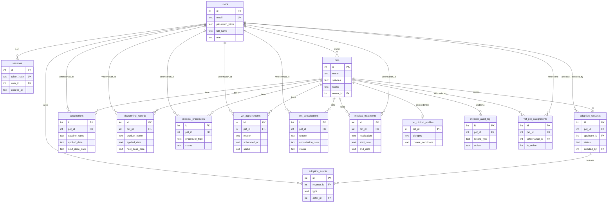

# PetGuardian — Base de Datos

Motor: **SQLite embebido** vía `better-sqlite3` (`^12.11.1`). No requiere servidor
de base de datos. El esquema se versiona y evoluciona por **migraciones**
declarativas en `backend/src/config/db.js`.

- **Versión actual del esquema:** `7`
- **Tabla de control:** `meta` (`key`, `value`), con `schema_version`
- **Archivo por defecto:** `backend/data/petguardian.db`
  (configurable con `DATABASE_FILE`)
- **Ruta:** absoluta tal cual o relativa a la raíz del backend
  (`backendRoot`).

---

## 1. PRAGMAs de conexión

Al abrir la base de datos (`getDatabase()`):

| PRAGMA | Valor | Motivo |
| --- | --- | --- |
| `journal_mode` | `WAL` | Lecturas concurrentes con una escritura |
| `foreign_keys` | `ON` | Se respetan las claves foráneas y los `ON DELETE` |
| `busy_timeout` | `5000` | Espera hasta 5 s si la BD está bloqueada |

Se genera además el archivo `-wal` / `-shm` junto a la BD (modo WAL).

---

## 2. Sistema de migraciones

`runMigrations(connection)`:

1. Crea la tabla `meta` si no existe.
2. Inserta `schema_version = '0'` con `ON CONFLICT DO NOTHING`.
3. Lee la versión actual.
4. Recorre `MIGRATIONS` en orden y aplica las de versión mayor a la actual,
   **cada una dentro de su propia transacción**, actualizando
   `schema_version` al terminar.

Todas las sentencias usan `CREATE TABLE IF NOT EXISTS` / `CREATE INDEX IF NOT
EXISTS`, por lo que la aplicación es **idempotente**. La versión se expone con
`getSchemaVersion()` (usada por `/api/health`).

### Historial de migraciones

| Versión | Nombre | Crea |
| --- | --- | --- |
| 1 | `users_and_sessions` | `users`, `sessions` + índice |
| 2 | `pets` | `pets` + 3 índices |
| 3 | `adoption_requests` | `adoption_requests`, `adoption_events` + índices + índice único parcial |
| 4 | `pet_health_records` | `vaccinations`, `deworming_records`, `medical_procedures`, `vet_appointments`, `vet_consultations` + índices |
| 5 | `vet_pet_assignments` | `vet_pet_assignments` (vínculo veterinario↔mascota) + índices |
| 6 | `clinical_case_file` | Columnas clínicas nuevas (consulta ampliada, anulación lógica) + `pet_clinical_profiles`, `medical_audit_log` + índice |
| 7 | `vital_signs_treatments_and_surgical_followup` | Signos vitales, seguimiento quirúrgico, `medical_treatments` + índices |

Todas las migraciones son **aditivas**: no eliminan, renombran ni sobrescriben
datos existentes.

---

## 3. Tabla `users`

| Columna | Tipo | Restricciones |
| --- | --- | --- |
| `id` | INTEGER | PK AUTOINCREMENT |
| `email` | TEXT | NOT NULL, UNIQUE (normalizado a minúsculas en el servicio) |
| `password_hash` | TEXT | NOT NULL (`scrypt$N$r$p$saltB64$hashB64`) |
| `full_name` | TEXT | NOT NULL |
| `role` | TEXT | NOT NULL, CHECK ∈ (`admin`, `fundacion`, `adoptante`, `veterinario`) |
| `created_at` | TEXT | NOT NULL DEFAULT `datetime('now')` |
| `updated_at` | TEXT | NOT NULL DEFAULT `datetime('now')` |

---

## 4. Tabla `sessions`

| Columna | Tipo | Restricciones |
| --- | --- | --- |
| `id` | INTEGER | PK AUTOINCREMENT |
| `token_hash` | TEXT | NOT NULL, UNIQUE (SHA-256 del token en claro) |
| `user_id` | INTEGER | NOT NULL, FK → `users(id)` ON DELETE CASCADE |
| `created_at` | TEXT | NOT NULL DEFAULT `datetime('now')` |
| `expires_at` | TEXT | NOT NULL |
| `last_used_at` | TEXT | NULL (se actualiza con `touchSession`) |

Índice: `idx_sessions_user_id (user_id)`.

> El token en claro nunca se guarda; solo su hash. Borrar un usuario elimina sus
> sesiones en cascada.

---

## 5. Tabla `pets`

| Columna | Tipo | Restricciones |
| --- | --- | --- |
| `id` | INTEGER | PK AUTOINCREMENT |
| `name` | TEXT | NOT NULL |
| `species` | TEXT | NOT NULL, CHECK ∈ (`perro`, `gato`, `otra`) |
| `breed` | TEXT | NULL |
| `sex` | TEXT | NOT NULL DEFAULT `desconocido`, CHECK ∈ (`macho`, `hembra`, `desconocido`) |
| `birth_date` | TEXT | NULL (`AAAA-MM-DD`) |
| `approximate_age_months` | INTEGER | NULL |
| `weight_kg` | REAL | NULL |
| `color` | TEXT | NULL |
| `description` | TEXT | NULL |
| `photo_url` | TEXT | NULL (URL http(s) o data URL) |
| `status` | TEXT | NOT NULL DEFAULT `disponible`, CHECK ∈ (`disponible`, `en_proceso`, `adoptada`, `bajo_cuidado`) |
| `owner_id` | INTEGER | NOT NULL, FK → `users(id)` ON DELETE CASCADE |
| `created_at` | TEXT | NOT NULL DEFAULT `datetime('now')` |
| `updated_at` | TEXT | NOT NULL DEFAULT `datetime('now')` |

Índices: `idx_pets_owner_id`, `idx_pets_status`, `idx_pets_species`.

> **Nota de legado:** el `CHECK` admite el valor `'otra'`, pero la capa de
> validación/API **rechaza** cualquier especie distinta de `perro`/`gato`
> (`400 validation_error`). La restricción de BD no se ha reducido todavía.

---

## 6. Tablas `adoption_requests` y `adoption_events`

### `adoption_requests`

| Columna | Tipo | Restricciones |
| --- | --- | --- |
| `id` | INTEGER | PK AUTOINCREMENT |
| `pet_id` | INTEGER | NOT NULL, FK → `pets(id)` ON DELETE CASCADE |
| `applicant_id` | INTEGER | NOT NULL, FK → `users(id)` ON DELETE CASCADE |
| `status` | TEXT | NOT NULL DEFAULT `pendiente`, CHECK ∈ (`pendiente`, `aprobada`, `rechazada`, `cancelada`) |
| `message` | TEXT | NULL (≤ 500 por validación) |
| `decision_note` | TEXT | NULL |
| `decided_by` | INTEGER | FK → `users(id)` ON DELETE SET NULL |
| `decided_at` | TEXT | NULL |
| `created_at` | TEXT | NOT NULL DEFAULT `datetime('now')` |
| `updated_at` | TEXT | NOT NULL DEFAULT `datetime('now')` |

Índices: `idx_adoption_requests_pet_id`, `idx_adoption_requests_applicant_id`,
`idx_adoption_requests_status`.

**Índice único parcial** (clave para la integridad de la adopción):

```sql
CREATE UNIQUE INDEX idx_adoption_requests_one_approved_per_pet
  ON adoption_requests(pet_id) WHERE status = 'aprobada';
```

Garantiza a nivel de base de datos que una mascota tenga **como mucho una**
solicitud aprobada, incluso ante escrituras concurrentes.

### `adoption_events`

| Columna | Tipo | Restricciones |
| --- | --- | --- |
| `id` | INTEGER | PK AUTOINCREMENT |
| `request_id` | INTEGER | NOT NULL, FK → `adoption_requests(id)` ON DELETE CASCADE |
| `type` | TEXT | NOT NULL, CHECK ∈ (`created`, `edited`, `approved`, `rejected`, `cancelled`) |
| `from_status` | TEXT | NULL |
| `to_status` | TEXT | NULL |
| `actor_id` | INTEGER | FK → `users(id)` ON DELETE SET NULL |
| `note` | TEXT | NULL |
| `created_at` | TEXT | NOT NULL DEFAULT `datetime('now')` |

Índice: `idx_adoption_events_request_id`.

---

## 7. Tablas clínicas (migraciones 4 y 6/7)

Todas comparten: `id` (PK), `pet_id` (FK → `pets` CASCADE), `veterinarian_id`
(FK → `users` SET NULL), `notes`, `created_by` (FK → `users` SET NULL),
`created_at`, `updated_at`. Desde la **migración 6** además `deleted_at` (TEXT) y
`deleted_by` (FK → `users` SET NULL) para la **anulación lógica** (los registros
clínicos nunca se borran físicamente).

### `vaccinations`

`vaccine_name` (NOT NULL), `applied_date` (NOT NULL), `next_dose_date`, `batch_number`.

Índices: `idx_vaccinations_pet_id`, `idx_vaccinations_next_dose_date`.

### `deworming_records`

`product_name` (NOT NULL), `deworming_type` (NOT NULL DEFAULT `interna`,
CHECK ∈ `interna`/`externa`/`mixta`), `applied_date` (NOT NULL), `next_dose_date`.

Índice: `idx_deworming_records_pet_id`.

### `medical_procedures`

`procedure_type` (NOT NULL), `status` (NOT NULL DEFAULT `pendiente`,
CHECK ∈ `pendiente`/`programado`/`realizado`/`cancelado`), `scheduled_date`,
`performed_date`, `pre_op_instructions` (v7), `post_op_notes` (v7),
`follow_up_date` (v7, próximo control).

Índices: `idx_medical_procedures_pet_id`, `idx_medical_procedures_status`,
`idx_medical_procedures_follow_up_date`.

### `vet_appointments`

`reason` (NOT NULL), `scheduled_at` (NOT NULL), `status` (NOT NULL DEFAULT
`programada`, CHECK ∈ `programada`/`completada`/`cancelada`).

Índices: `idx_vet_appointments_pet_id`, `idx_vet_appointments_scheduled_at`.

### `vet_consultations`

`reason` (NOT NULL), `consultation_date` (NOT NULL), `status` (NOT NULL DEFAULT
`abierta`, CHECK ∈ `abierta`/`cerrada`), `examination`, `findings`, `diagnosis`,
`treatment`, `evolution`, `closed_at`, y los **signos vitales** (v7):
`weight_kg`, `temperature_c`, `heart_rate_bpm`, `respiratory_rate_rpm`.

Índice: `idx_vet_consultations_pet_id`.

### `medical_treatments` (migración 7)

Tratamientos con medicamentos. Reutiliza la base clínica común y añade:
`medication` (NOT NULL), `dose`, `route`, `frequency`, `duration`,
`start_date` (NOT NULL), `end_date`, `instructions`.

Índices: `idx_medical_treatments_pet_id`, `idx_medical_treatments_end_date`.

---

## 7.1 `pet_clinical_profiles` (migración 6)

Antecedentes del paciente (uno por mascota):

| Columna | Tipo | Restricciones |
| --- | --- | --- |
| `pet_id` | INTEGER | PK, FK → `pets(id)` ON DELETE CASCADE |
| `allergies` | TEXT | NULL |
| `chronic_conditions` | TEXT | NULL |
| `clinical_history` | TEXT | NULL |
| `notes` | TEXT | NULL |
| `updated_by` | INTEGER | FK → `users(id)` ON DELETE SET NULL |
| `created_at` / `updated_at` | TEXT | NOT NULL DEFAULT `datetime('now')` |

## 7.2 `medical_audit_log` (migración 6)

Bitácora de auditoría clínica:

| Columna | Tipo | Restricciones |
| --- | --- | --- |
| `id` | INTEGER | PK AUTOINCREMENT |
| `pet_id` | INTEGER | NOT NULL, FK → `pets(id)` ON DELETE CASCADE |
| `record_type` | TEXT | NOT NULL (tipo médico o `clinical_profile`) |
| `record_id` | INTEGER | NULL |
| `action` | TEXT | NOT NULL, CHECK ∈ (`created`, `updated`, `closed`, `reopened`, `voided`, `profile_updated`) |
| `actor_id` | INTEGER | FK → `users(id)` ON DELETE SET NULL |
| `changes` | TEXT | NULL (JSON con campos afectados) |
| `created_at` | TEXT | NOT NULL DEFAULT `datetime('now')` |

Índice: `idx_medical_audit_log_pet_id (pet_id, id)`.

## 7.3 `vet_pet_assignments` (migración 5)

Vínculo explícito veterinario ↔ mascota (paciente). Un veterinario solo accede al
expediente de sus pacientes **asignados y activos**. La desasignación es lógica
(`is_active = 0`) para conservar la trazabilidad.

| Columna | Tipo | Restricciones |
| --- | --- | --- |
| `id` | INTEGER | PK AUTOINCREMENT |
| `pet_id` | INTEGER | NOT NULL, FK → `pets(id)` ON DELETE CASCADE |
| `veterinarian_id` | INTEGER | NOT NULL, FK → `users(id)` ON DELETE CASCADE |
| `is_active` | INTEGER | NOT NULL DEFAULT `1` |
| `assigned_by` | INTEGER | FK → `users(id)` ON DELETE SET NULL |
| `created_at` / `updated_at` | TEXT | NOT NULL DEFAULT `datetime('now')` |
| `removed_by` | INTEGER | FK → `users(id)` ON DELETE SET NULL |
| `removed_at` | TEXT | NULL |

Índices: único `idx_vet_pet_assignments_unique (pet_id, veterinarian_id)`,
`idx_vet_pet_assignments_vet`, `idx_vet_pet_assignments_pet`.

---

## 8. Modelo entidad-relación



---

## 9. Reglas de borrado (ON DELETE)

| Tabla hija | FK | Acción |
| --- | --- | --- |
| `sessions.user_id` | users | CASCADE |
| `pets.owner_id` | users | CASCADE |
| `adoption_requests.pet_id` | pets | CASCADE |
| `adoption_requests.applicant_id` | users | CASCADE |
| `adoption_requests.decided_by` | users | SET NULL |
| `adoption_events.request_id` | adoption_requests | CASCADE |
| `adoption_events.actor_id` | users | SET NULL |
| *(todas las clínicas)* `.pet_id` | pets | CASCADE |
| *(todas las clínicas)* `.veterinarian_id` | users | SET NULL |
| *(todas las clínicas)* `.created_by` | users | SET NULL |
| *(todas las clínicas)* `.deleted_by` | users | SET NULL |
| `pet_clinical_profiles.pet_id` | pets | CASCADE |
| `pet_clinical_profiles.updated_by` | users | SET NULL |
| `medical_audit_log.pet_id` | pets | CASCADE |
| `medical_audit_log.actor_id` | users | SET NULL |
| `vet_pet_assignments.pet_id` | pets | CASCADE |
| `vet_pet_assignments.veterinarian_id` | users | CASCADE |
| `vet_pet_assignments.assigned_by` / `removed_by` | users | SET NULL |

Eliminar una mascota elimina en cascada sus solicitudes, eventos, **todo su
expediente clínico** (incluidos tratamientos, antecedentes, auditoría y
asignaciones). Eliminar un usuario desvincula (SET NULL) las referencias de
autoría sin borrar los registros; las asignaciones veterianarias del usuario se
eliminan en cascada.

---

## 10. Transacciones

`runImmediateTransaction(fn)` envuelve `fn` en
`db.transaction(fn).immediate()` (`BEGIN IMMEDIATE`), tomando el bloqueo de
escritura de inmediato. Se usa en la **aprobación de adopciones** para
serializar decisiones concurrentes; ver
[`ALGORITMOS_Y_REGLAS.md`](./ALGORITMOS_Y_REGLAS.md).

---

## 11. Acceso programático

`backend/src/config/db.js` exporta:

| Función | Descripción |
| --- | --- |
| `getDatabase()` | Abre (si hace falta), aplica PRAGMAs y migra; devuelve la conexión única |
| `runImmediateTransaction(fn)` | Transacción `IMMEDIATE` |
| `getSchemaVersion()` | Valor de `meta.schema_version` |
| `checkDatabase()` | `{ connected: boolean, error? }` |
| `closeDatabase()` | Cierra la conexión y la deja a `null` (usado en `server.js`) |

La conexión es **única por proceso** (singleton). Los repositorios en
`backend/src/data/*.repository.js` usan `getDatabase()` y sentencias
preparadas con parámetros con nombre (`@campo`), evitando inyección SQL.

---

## 12. Inspección manual

```powershell
# Desde backend/, con sqlite disponible; o vía Node:
node -e "import('./src/config/db.js').then(m => { console.log(m.getSchemaVersion()); console.log(m.getDatabase().prepare('SELECT COUNT(*) AS n FROM pets').get()); })"
```

Tablas del esquema v7: `meta`, `users`, `sessions`, `pets`,
`adoption_requests`, `adoption_events`, `vaccinations`, `deworming_records`,
`medical_procedures`, `vet_appointments`, `vet_consultations`,
`vet_pet_assignments`, `pet_clinical_profiles`, `medical_audit_log`,
`medical_treatments`.
