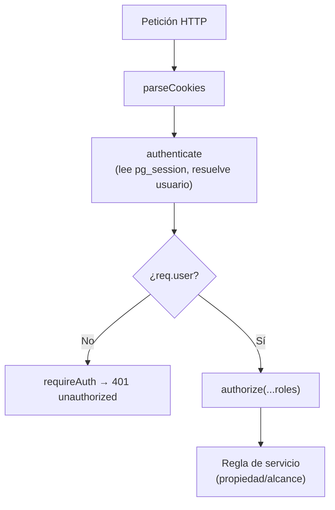
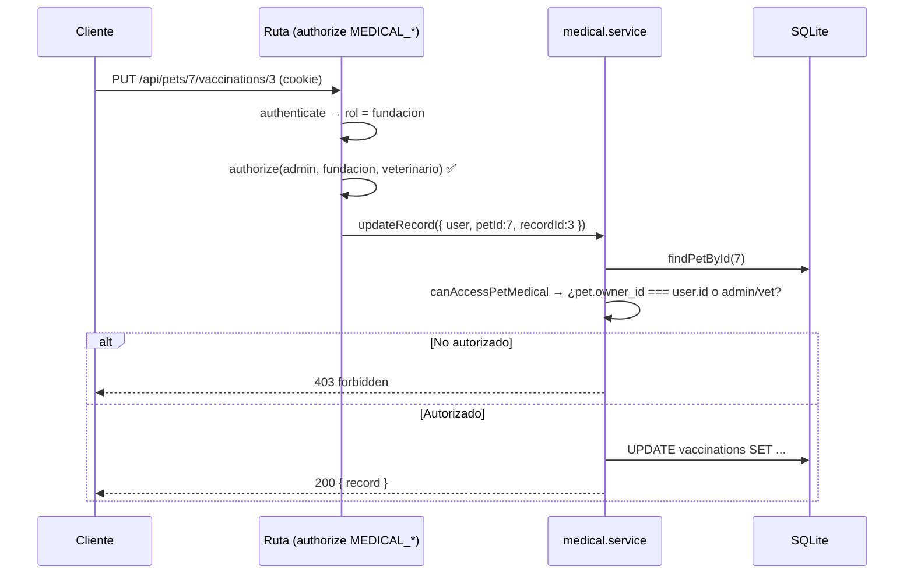

# PetGuardian — Roles y Permisos

Control de acceso basado en roles (**RBAC**) resuelto íntegramente en el
servidor. El cliente nunca decide permisos; solo adapta la interfaz a lo que el
rol puede ver.

Fuentes de verdad:

- `backend/src/config/roles.js` — definición de roles y conjuntos.
- `backend/src/middlewares/auth.js` — `authenticate`, `requireAuth`, `authorize`.
- `backend/src/routes/*` — niveles de acceso por ruta.
- `backend/src/services/*` — reglas de propiedad/alcance a nivel de recurso.

---

## 1. Roles

| Valor | Etiqueta | Registro público | Descripción |
| --- | --- | :---: | --- |
| `admin` | Administrador | ❌ | Acceso global a todo el sistema |
| `fundacion` | Fundación | ✅ | Dueña de mascotas; gestiona su refugio y decide adopciones de **sus** mascotas |
| `adoptante` | Adoptante | ✅ | Explora mascotas y crea solicitudes |
| `veterinario` | Veterinario aliado | ✅ | Gestiona el expediente clínico de **sus pacientes asignados** (`vet_pet_assignments`) |

El rol `admin` **no** es registrable públicamente; se crea con
`node scripts/create-admin.mjs` (variables `ADMIN_EMAIL`, `ADMIN_PASSWORD`,
`ADMIN_NAME`).

---

## 2. Conjuntos de roles (configuración)

Definidos en `backend/src/config/roles.js` y consumidos por rutas y servicios:

| Constante | Roles incluidos | Uso |
| --- | --- | --- |
| `PUBLIC_REGISTER_ROLES` | `adoptante`, `fundacion`, `veterinario` | Roles admitidos en el registro |
| `PET_WRITE_ROLES` | `admin`, `fundacion` | Crear/editar/eliminar mascotas |
| `MEDICAL_READ_ROLES` | `admin`, `fundacion`, `veterinario` | Leer el expediente clínico |
| `MEDICAL_WRITE_ROLES` | `admin`, `fundacion`, `veterinario` | Crear/editar/eliminar registros clínicos |
| `ADOPTION_REQUEST_ROLES` | `adoptante` | Crear solicitudes de adopción |
| `ADOPTION_DECISION_ROLES` | `admin`, `fundacion` | Aprobar/rechazar solicitudes |
| `ADOPTION_READ_ROLES` | `admin`, `fundacion`, `adoptante` | Listar/ver adopciones |

---

## 3. Autenticación de la petición

- `authenticate` corre en **todas** las peticiones y es tolerante: si no hay
  cookie o es inválida/expirada, deja `req.user = null` sin bloquear.
- `requireAuth` responde `401 unauthorized` si no hay usuario.
- `authorize(...roles)` responde `403 forbidden` si el rol no está permitido.

---

## 4. Matriz de acceso por endpoint

Leyenda: **✅** permitido · **propias** solo sobre recursos propios · **—** prohibido.

| Endpoint | admin | fundacion | veterinario | adoptante |
| --- | :---: | :---: | :---: | :---: |
| `GET /api/health` (público) | ✅ | ✅ | ✅ | ✅ |
| `POST /api/auth/register` (público) | ✅ | ✅ | ✅ | ✅ |
| `POST /api/auth/login` (público) | ✅ | ✅ | ✅ | ✅ |
| `GET /api/auth/roles` (público) | ✅ | ✅ | ✅ | ✅ |
| `POST /api/auth/logout` | ✅ | ✅ | ✅ | ✅ |
| `GET /api/auth/me` | ✅ | ✅ | ✅ | ✅ |
| `GET /api/users` | ✅ | — | — | — |
| `GET /api/users/veterinarians` | ✅ | ✅ | ✅ | — |
| `GET /api/dashboard` | ✅ | propias | ✅ | propias |
| `GET /api/pets` | ✅ | ✅ | ✅ | ✅ |
| `GET /api/pets/:id` | ✅ | ✅ | ✅ | ✅ |
| `POST /api/pets` | ✅ | ✅ | — | — |
| `PUT /api/pets/:id` | ✅ (todas) | propias | — | — |
| `DELETE /api/pets/:id` | ✅ (todas) | propias | — | — |
| `GET /api/pets/:petId/veterinarians` | ✅ | propias | asignado | — |
| `POST /api/pets/:petId/veterinarians` | ✅ | propias | — | — |
| `DELETE /api/pets/:petId/veterinarians/:vid` | ✅ | propias | — | — |
| `GET /api/pets/:petId/clinical-profile` | ✅ | propias | asignado | — |
| `PUT /api/pets/:petId/clinical-profile` | ✅ | propias | asignado | — |
| `GET /api/pets/:petId/clinical-audit` | ✅ | propias | asignado | — |
| `GET /api/pets/:petId/clinical-controls` | ✅ | propias | asignado | — |
| `GET /api/pets/:petId/:type` | ✅ | propias | asignado | — |
| `GET .../:type/:recordId` | ✅ | propias | asignado | — |
| `POST /api/pets/:petId/:type` | ✅ | propias | asignado | — |
| `PUT .../:type/:recordId` | ✅ | propias | asignado | — |
| `DELETE .../:type/:recordId` | ✅ | propias | asignado | — |
| `GET /api/clinical/agenda` | ✅ | — | ✅ (sus pacientes) | — |
| `GET /api/clinical/calendar` | ✅ | — | ✅ (sus pacientes) | — |
| `GET /api/adoptions` | ✅ (todas) | propias | — | propias |
| `POST /api/adoptions` | — | — | — | ✅ |
| `GET /api/adoptions/:id` | ✅ | propias | — | propias |
| `GET /api/adoptions/:id/events` | ✅ | propias | — | propias |
| `PUT /api/adoptions/:id` | ✅ | — | — | propias |
| `POST /api/adoptions/:id/approve` | ✅ | propias | — | — |
| `POST /api/adoptions/:id/reject` | ✅ | propias | — | — |
| `POST /api/adoptions/:id/cancel` | ✅ | — | — | propias |

### Notas de matríz

- **`PUT /api/adoptions/:id`**: el adoptante solo edita **sus** solicitudes
  `pendiente`; el admin puede editar cualquiera (en estado pendiente). La
  fundación no está en `ADOPTION_REQUEST_ROLES` ni en la ruta de edición, por lo
  que recibe `403`.
- **`POST /api/adoptions/:id/cancel`**: lo solicita el adoptante dueño o el
  admin, no la fundación.
- **`approve`/`reject`**: el admin puede decidir cualquier solicitud; la
  fundación solo las de **sus** mascotas (verificado en el servicio).

---

## 5. Reglas de propiedad y alcance (nivel servicio)

El nivel de ruta es grueso; el alcance real se resuelve en el servicio.

### Mascotas

- **Crear:** la mascota se asigna al `owner_id` del usuario `fundacion` que la
  crea; el admin también puede crear.
- **Editar/eliminar:** `canManagePet` permite al **dueño** o al `admin`.
- Un usuario `veterinario` o `adoptante` no gestiona mascotas.

### Expediente clínico (`canAccessPetMedical`)

- `admin`: cualquier mascota.
- `veterinario`: **solo sus pacientes asignados y activos**
  (`vet_pet_assignments.is_active = 1`).
- `fundacion`: **solo** mascotas propias.
- `adoptante`: sin acceso (403). La restricción se aplica también al **leer**
  (no solo por `authorize`), evitando fugas del historial clínico.

### Vínculo veterinario ↔ mascota

- **Asignar/desasignar:** `admin` o la fundación **propietaria** (mismo criterio
  que `canManagePet`); el veterinario **no** puede auto-asignarse.
- **Consultar el vínculo:** `admin`, la fundación propietaria o el propio
  veterinario asignado.
- La desasignación es **lógica** (`is_active = 0`) y conserva la trazabilidad
  (`assigned_by`, `removed_by`, fechas).
- La agenda y el calendario clínicos reutilizan este alcance: un veterinario solo
  ve las citas/procedimientos/tratamientos de sus pacientes asignados.

### Adopciones (visibilidad)

| Rol | Solicitudes visibles |
| --- | --- |
| `adoptante` | Solo las propias (`applicant_id`) |
| `fundacion` | Solo las de sus mascotas (`pets.owner_id`) |
| `admin` | Todas |

- **Decidir** (`approve`/`reject`): `admin` o la fundación dueña de la mascota.
- **Editar** (`PUT`): el solicitante o el `admin`.
- **Cancelar**: el solicitante o el `admin`.

### Panel

La composición del dashboard depende del rol:

| Rol | `pets` | `adoptions` | `medical` + `attention` |
| --- | :---: | :---: | :---: |
| `admin` | ✅ global | ✅ global | ✅ global |
| `fundacion` | ✅ propias | ✅ propias | ✅ propias |
| `veterinario` | ✅ asignadas | — | ✅ asignados |
| `adoptante` | ✅ global | ✅ propias | — |

---

## 6. Privacidad

- El historial clínico **nunca** se expone al `adoptante` (ni por rol de ruta ni
  por servicio).
- `GET /api/users` (solo admin) y `GET /api/users/veterinarians` nunca devuelven
  `password_hash`.
- El directorio de veterinarios expone únicamente `{ id, fullName }`.

---

## 7. Navegación por rol (frontend)

`frontend/src/constants/navigation.js` define los tabs y `isTabAllowed` alinea
la UI con los permisos del backend:

| Rol | Tabs |
| --- | --- |
| `adoptante` | Inicio, Mascotas disponibles, Mis solicitudes, Mi perfil |
| `fundacion` | Panel, Alertas, Mascotas, Adopciones, Mi perfil |
| `veterinario` | Inicio clinico, Pacientes, Alertas clinicas, Mi perfil |
| `admin` | Panel, Usuarios, Mascotas, Mi perfil |

El shell **oculta** cualquier sección que el rol no pueda ver; aun así, la
autorización efectiva está en el servidor.

---

## 8. Secuencia de autorización de una escritura clínica

